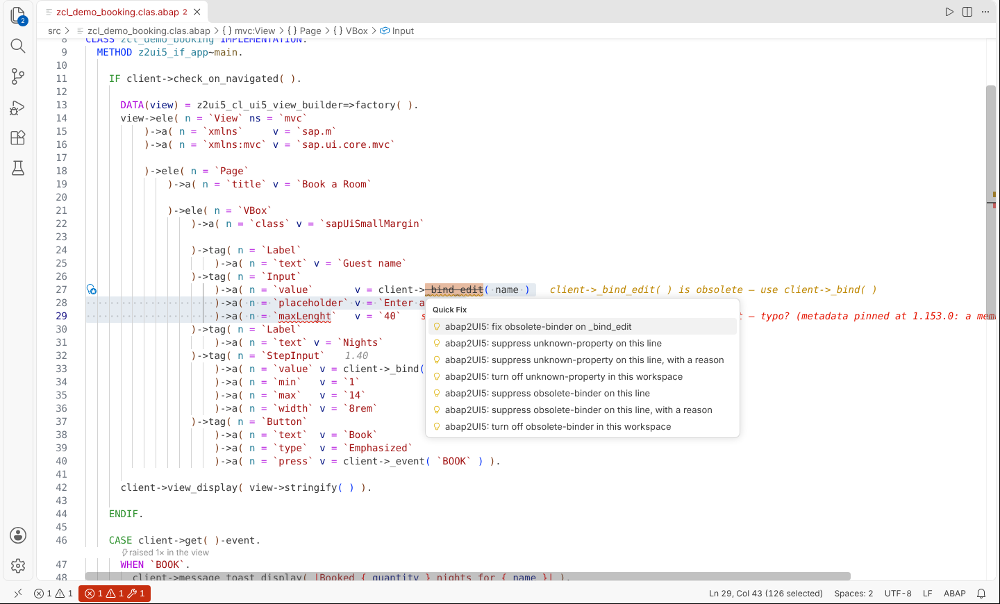
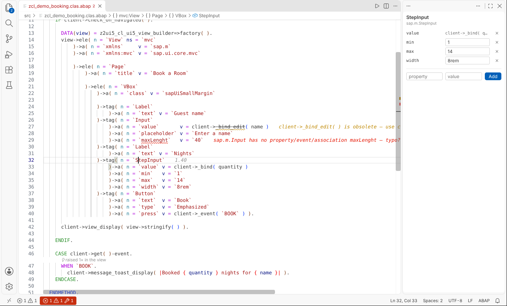
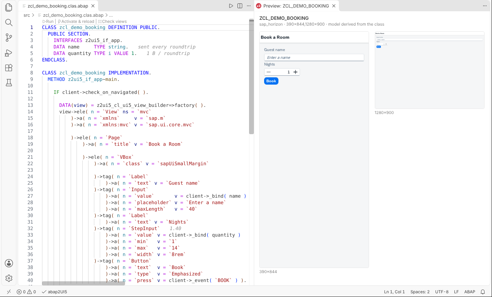

# abap2UI5 for VS Code

VS Code extension for developing **abap2UI5** apps: launch an app with **F9**,
see it right next to the source, and have it reload automatically when you
activate the class — without the context switch to the browser. The whole
[abap2UI5-linter](https://github.com/abap2UI5/linter) runs in the editor while
you type, so a broken view is a squiggle rather than a blank screen.

Works with any system running abap2UI5 (on-premise or cloud). The only thing
tying the extension to a system is the launch URL you configure once.

## Documentation

**→ [The extension, in full](https://abap2ui5.github.io/docs/advanced/vscode.html)**
— F9 and the embedded preview, the auth proxy and why it exists, reload on
activation, the view checks and quick fixes, completion and hover for the whole
UI5 API, the systemless view preview, the refactorings, the MCP servers, what
works in the browser, and every setting.

## Installing

Install **abap2UI5** from the
[VS Code Marketplace](https://marketplace.visualstudio.com/items?itemName=abap2ui5.abap2ui5):
Extensions panel (`Ctrl/Cmd + Shift + X`) → search for *abap2UI5* →
**Install**. Through the terminal:

```bash
code --install-extension abap2ui5.abap2ui5
```

On [Open VSX](https://open-vsx.org/extension/abap2ui5/abap2ui5) for VSCodium,
Eclipse Theia, SAP Business Application Studio and friends. Without Marketplace
access, every
[release](https://github.com/abap2UI5/vscode-extension/releases/latest) carries
the `.vsix` — Extensions panel → `…` menu → **Install from VSIX…** — or build
it yourself, see *Packaging* below.

> **Coming from a pre-Marketplace `.vsix` install?** Those builds used the
> placeholder publisher `abap2ui5-local`, which makes them a different
> extension to VS Code — they keep working but never update. Uninstall once
> (`code --uninstall-extension abap2ui5-local.abap2ui5`), then install from the
> Marketplace. Settings are kept; the stored SAP credentials are asked for once
> again.

On the first F9 the extension asks for the launch URL, with `{class}` as the
placeholder:

```
https://host:44300/sap/bc/z2ui5?app_start={class}&sap-client=100
```

## What you get

- **F9 runs the app** next to the source, and the cursor stays where it was.
  **Ctrl+F3** activates the class through your ABAP tooling and reloads the
  preview — activations done any other way are noticed on the server too.
  In an app class **on disk** (an abapGit checkout, the layout app-template
  creates) Ctrl+F3 runs **Push and Activate** instead: the class and its local
  includes (`.clas.locals_def.abap`, `.clas.locals_imp.abap`,
  `.clas.testclasses.abap`) are written to the system over ADT - locked,
  written where they differ, unlocked, activated - and the preview reloads.
  The class must already exist on the system. You are asked before the first
  push of a class to a system, shown a diff when the server changed since your
  last push or F9, and asked for a transport request when the system wants
  one; production systems and Restricted Mode are refused. Activation errors
  land in the Problems view on their line, in the file they belong to.
- **The preview is more than a browser tab**: device widths, themes and
  languages; runtime errors forwarded into the editor; a click-the-control →
  jump-to-the-builder-call inspector; the live JSON model; a traffic log with
  roundtrip timings; headless screenshots; and a pin that carries the model
  across a reload.
- **Static view checks while you type** — the linter's property gate in
  process, the abap2UI5 rules with it, the render gate on demand. Quick fixes,
  waivers that CI honours, and a findings view grouping the repository's
  findings by rule. An open `abaplint.jsonc` whose abap2UI5 pin is below the
  release the bundled linter assumes gets a warning on its `branch` line.

  
- **The whole UI5 API in completion and hover**, plus the binding paths your
  class's model actually has, and the `client->` API with its ABAP signature.
- **Write the view faster**: Format Document repairs a chain's indentation,
  Emmet-style abbreviations expand into one, Extract to View Method splits a
  long one, *Convert XML View to Builder Chain* turns a demo kit sample
  into ABAP, and the *Control Properties* view edits the attributes of the
  control under the cursor.

  
- **See the view without a system** — *Preview View (No System)* renders what
  the class builds, with a device matrix and a compare-with-HEAD mode.

  
- **Run the app without a system** — pick *Local (transpiled)* in *Select
  System* and F9 transpiles the workspace's classes and runs them on this
  machine, in the same preview: events, the inspector, the live model and
  the traffic log work as against a system
  ([details](#running-an-app-without-a-system)).
- **Test without a system** — *Run Unit Tests (No System)* runs the app's
  ABAP Unit tests in the transpiled abap2UI5 backend through
  [mcp-server](https://github.com/abap2UI5/mcp-server)'s `abap2ui5-unit`, in
  a terminal, for one class or the whole `src/`: the editor's counterpart of
  `npm run test:unit` in a project from app-template. The same tests are
  listed in the Testing view, per test class and method, with each result on
  its method.
- **Migrate a classic report** — *Migrate Classic Report to abap2UI5* turns a
  `*.prog.abap` into an [abap-cloud-gui](https://github.com/abap2UI5-addons/abap-cloud-gui)
  report class with its converter report2UI5, opens the class beside its
  migration report and puts every statement it refuses into Problems
  ([details](#migrating-a-classic-report)).
- **Navigate an app**: the view hierarchy in the Outline pane, Go to Definition
  between an event and its `WHEN`, F2 renaming every literal an app is wired
  together with, Find All References (Shift+F12) listing the same places, and
  a navigation map of the workspace's apps.
- **Open a class from a link**: `vscode://abap2ui5.abap2ui5/open?code=…`
  or `?src=<raw GitHub URL>` opens the class unsaved, ready for F9.
- **Templates**: *New App from Template* is a gallery of linter-clean
  skeletons; *New Project from Template* writes a whole
  [app-template](https://github.com/abap2UI5/app-template) project.
- **For AI agents**: the
  [abap2UI5 MCP server](https://github.com/abap2UI5/mcp-server) registered for
  every MCP client in the window, plus a second, in-extension server holding
  what only the extension has — the configured systems, the credentials and the
  proxy (`list_systems`, `search_apps`, `run_app_on_system`), and, once you
  allow it, the [app tools](#agent-app-tools-on-the-system) that let an agent
  operate an app on the system through its JSON protocol. *Add Agent Setup
  to Workspace* makes an existing project agent-ready: app-template's
  `AGENTS.md`, `CLAUDE.md`, the four skills, `.mcp.json`, the two gates and
  `check.yml`, from the bundled snapshot - nothing overwritten,
  `package.json` and `.gitignore` merged, the gates pointed at your
  `STARTING_FOLDER`, the same files as
  `npm create abap2ui5-app@latest -- --agent-setup`. The setup for
  every agent, the Claude Code plugin among them, is on the
  [AI page](https://abap2ui5.github.io/docs/get_started/ai.html) of the
  documentation.
- **Works in the browser** — vscode.dev, github.dev and browser-based SAP
  Business Application Studio get the language half.

## Systems and logon

F9 loads the app through a local auth proxy that logs on to the system for
the preview, so the inspector, the live model, the traffic log, screenshots
and the system MCP tools all work. Each entry of `abap2ui5.systems` names how
that proxy logs on, in its `auth` field:

| `auth` | How | What is stored |
| --- | --- | --- |
| `"basic"` (default) | user and password, asked for once per host | both in the VS Code SecretStorage |
| `"certificate"` | an X.509 client certificate the system maps to your user - a `.pfx`/`.p12` file, or a PEM certificate and its key | the file PATH in VS Code's machine-local state, the passphrase in the SecretStorage; the file is read each time the proxy starts |

```json
"abap2ui5.systems": [
  { "name": "DEV", "url": "https://dev:44300/sap/bc/z2ui5?app_start={class}&sap-client=100", "auth": "certificate" }
]
```

For a `"certificate"` system, F9 asks for the file the first time (or run
**abap2UI5: Choose Client Certificate**); a certificate that has expired, or
whose passphrase does not open it, is refused before anything is sent, and
one that expires within 14 days is warned about. A certificate kept in the
Windows certificate store or on a smart card with a non-exportable key cannot
be used this way. A self-signed server certificate is trusted per system as
before (*Trust This Certificate*), and both work together. A mechanism other
than basic that your user settings name for a host stays in effect when a
workspace lists the same host without it. **Clear Stored SAP Credentials**
forgets passwords, passphrases and certificate choices alike.

**Check System Connection** reports a missing or refused client certificate
as its own step, and for a system that answers without offering basic auth
it names the `auth` field. A browser (SSO) logon is planned; until then such
a system runs with `abap2ui5.openMode` set to `"external"`.

## Agent app tools on the system

The **abap2UI5 System** MCP server offers four tools that operate an
abap2UI5 app *semantically* on the active SAP system: an agent fills fields by
model path or label and fires events by name, over the same JSON protocol the
browser frontend speaks - no browser, no CSS selector, no screenshot. Every
answer is an **agent snapshot v1**: the fields with their values and whether
they are editable, the actions with their arguments, the tables, the
messages, some static text.

| Tool | What it does |
| --- | --- |
| `app_list` | Class names on the system, from the ADT quick search (`filter`: the start of the name, `*` as wildcard, default `Z`; at most 50). A name search: whether a class implements `z2ui5_if_app` is not checked. |
| `app_start` | Starts `app` and answers with its snapshot; optional `values` become pending edits, `max_rows` sizes the tables (default 20, max 200). |
| `app_describe` | The current snapshot of a `session`, from memory - nothing is sent. |
| `app_act` | Fills `values` and fires `event` (a name or an action id) with `args`/`row`, then answers with the new snapshot. Without `event` the values stay pending, as typing does in the browser. |

They are the same tools, with the same input, snapshot and refusals, as the
sandbox tools of the [abap2UI5 MCP server](https://github.com/abap2UI5/mcp-server)
(see its [`docs/agent-snapshot.md`](https://github.com/abap2UI5/mcp-server/blob/ea4e9fa8f6eaeca8f9c975a1c4fbd532c44ff76c/docs/agent-snapshot.md), at the vendored commit):
an event that is not on the screen, a field that is not editable, a choice
outside its values is refused with what *is* allowed, and nothing is sent.
The code behind the snapshot is that server's own, vendored into
`src/vendor/agent/` (see [Development](#development)). What differs on a
real system:

- **They act for real, as the configured user.** An event may save, post or
  delete data. So the tools answer only while
  `abap2ui5.agent.enableAppTools` is on - off by default, and settable in your
  User settings only, never by a workspace. While it is off they stay listed
  and answer with how to switch them on, without contacting the system.
- **Every acting step asks you first.** While
  `abap2ui5.agent.confirmActions` is on (the default; User settings only,
  too), each event `app_act` fires and the first `app_start` of a class
  opens a dialog that names the system, the class, the event, its arguments
  and the values sent with it: *Allow*, *Allow for This Session* (that class
  on that system, until the window closes) or *Deny*. Deny - or no answer
  within two minutes - tells the agent that you declined, and nothing is
  sent.
- **The active system.** Like `run_app_on_system` they work on the system
  *Select System* made active, through the auth proxy (the credentials stay
  there; the requests show in the traffic log). The optional `system`
  argument of `app_list`/`app_start` must name that system - the tools never
  switch. A session remembers its system, and `app_act` refuses it while
  another system is active.
- **The launch URL** must carry the class as a query parameter
  (`…/sap/bc/z2ui5?app_start={class}&sap-client=100`): the tools post to that
  endpoint without the class, as the browser posts to its own page. They
  handle what a browser would - a CSRF token layer in front of the system, a
  stateful session's `sap-contextid`, the system's cookies.
- `app_start` also accepts a namespaced class (`/ns/cl_app`).

## Migrating a classic report

*Migrate Classic Report to abap2UI5* (Command Palette, or the context menu
of a `*.prog.abap` in the editor and the Explorer) converts a classic report
into a class of the [abap-cloud-gui](https://github.com/abap2UI5-addons/abap-cloud-gui)
addon, which keeps the programming model of a report: the event blocks as
methods, `write( )`, `alv( )` and `message( )` as calls. The converter is the
addon's own report2UI5 (`tools/report2ui5` in that repository - called
report2cloud, in `tools/report2cloud`, up to the addon's 1.0.0; a checkout of
either shape works), the converter behind the MCP server's `migrate_report`
tool. It is not on npm - and it needs no checkout either: the first time,
the command offers *Install* (or run *Install Report Converter* yourself),
one click that downloads the converter at the abap-cloud-gui commit this
extension release pins, unpacks only the converter's own files from it -
each checked against the size and SHA-256 recorded for it - and every npm
package of its parser, each checked against its lockfile integrity, into
the extension's storage (about 2 MB downloaded, 8 MB on disk). The
pinned commit moves with extension releases, never with the addon's branch.
Nothing is downloaded or run from there in Restricted Mode.

A checkout of your own still wins over the installed copy, in this order:
`abap2ui5.report2cloud.path`, then the `ABAP_CLOUD_GUI_HOME` environment
variable the MCP server reads, then an abap-cloud-gui folder under
`abap2ui5.mcp.reposRoot`, and only then the installed copy. A checkout you
named that does not hold the converter is reported as such - the command
does not quietly use the installed copy instead. A checkout of your own is
made with:

```sh
git clone https://github.com/abap2UI5-addons/abap-cloud-gui
cd abap-cloud-gui && npm ci
```

A checkout without its `npm ci` gets *Run npm ci*. The converter runs with
VS Code's own Node.js.

1. It asks for the class name - the converter's default, `zcl_` + the report
   name, is preselected - and whether to write next to the report or into
   another folder; existing files of that class are only replaced after you
   confirm.
2. The class (`.clas.abap`, `.clas.xml`, the report's local classes as
   `.clas.locals_def/_imp.abap`) and `<class>.migration.md` are written in
   abapGit format, with the report's text pool when its `.prog.xml` lies
   beside it. The class opens with the migration report beside it - the work
   list of TODOs and what the list does not carry over. (The 1.0.0 converter
   also listed the tables and APIs not released on ABAP Cloud; report2UI5
   converts the user interface only and copies the report's logic as it is
   written, so whether that runs on the target system is yours to check.)
3. A statement with no counterpart in a browser app (`CALL SCREEN`, a dynpro
   module, ...) is **refused** - which ones is the converter's decision, and
   report2UI5 refuses fewer than 1.0.0 did (it copies native SQL and batch
   input as written, for example): each one is
   an error in Problems, on the statement in the report, and no class is
   written. *Write Partial Result* writes the draft anyway, the refused
   statements marked in it.
4. When the new class builds a view of its own, *Preview View (No System)*
   and *Check Views* are offered on it. A plain report class draws its screen
   through `z2ui5_cl_cgui_report` and has no view of its own to check.

A namespaced class name (`/ns/cl_x`) is not offered here: the converter does
not turn such a name into abapGit's file names (`#ns#cl_x.clas.abap`) for
the class it writes.

## Running an app without a system

*abap2UI5: Select System* offers a built-in profile, **Local (transpiled)**,
next to the configured systems - and F9 offers it when no system is
configured at all. On that profile F9:

1. saves the open ABAP documents of the project and collects every class,
   interface, table and data element of the folder the class lives in -
   `.abapgit.xml`'s `STARTING_FOLDER`, else `src/`, else the project folder
   (a class outside it is built from its own folder);
2. transpiles them against `@abap2ui5/node-runtime` - the release the
   project's `abaplint.jsonc` pins (from 1.145.0 on), else the latest - with
   [mcp-server](https://github.com/abap2UI5/mcp-server)'s npm backend, the
   build `abap2ui5-unit` uses;
3. serves them on `127.0.0.1` and loads `/?app_start=<CLASS>` through the
   extension's auth proxy into the usual preview. UI5 itself comes from
   `sdk.openui5.org`.

The build log is in the **abap2UI5 Local Backend** output. The first start
installs the runtime (about 60 MB, into the extension's global storage) and
fetches open-abap-core with `git`, so it needs Node.js 22, npm, git and the
network and takes a minute; a rebuild takes seconds. A **save** of an object
in the built folder (unless `abap2ui5.reloadOn` is `never`) and
**Ctrl+F3** rebuild, restart and reload - there is no activation, the file on
disk is the version. F9 with nothing changed only reloads.

The program is mcp-server, pinned to one exact version
(`localBackend.mcpServer` in the extension's `package.json`): a checkout
under `abap2ui5.mcp.reposRoot` when there is one, else
`npx --yes -p @abap2ui5/mcp-server@<version>`, which npm caches after the
first run. mcp-server has no `serve` command yet, so the extension ships a
small launcher (`dist/localbackend-host.mjs`) that calls its build and host
functions.

What to know:

- **It runs the repository's code** - transpiled, on your machine. It is
  never started in Restricted Mode, and it stops with the window, when
  another system is selected and when it is rebuilt.
- **Nothing is reachable from outside.** The server listens on `127.0.0.1`
  only, refuses a request not addressed to loopback, and answers 404 to
  every request without a random per-start token that only the auth proxy
  holds; the preview talks to the proxy alone. With `openMode` `external`
  the app opens in the tab instead - a browser could not reach it.
- **Only what the folder holds exists.** A class that reads a database
  table the folder does not define, or calls a class it does not contain,
  fails in the transpiled runtime - as it would in `abap2ui5-unit`.
- **`<class>.mock.json` is not applied.** The backend has no way yet to
  preset an app's attributes before its first `main( )`; the app starts with
  what its own code initialises, and the output says so when a mock file is
  there.
- No ADT behind it: *Check System Connection*, *Run an App from the System*
  and the agent app tools do not work on this profile.
- Desktop only.

## Commands

All of them are in the Command Palette (`Ctrl/Cmd + Shift + P`) under
*abap2UI5*; the few with a key are the ones you reach for while typing. This
reference is generated from `package.json` with `npm run commands`, and
`npm run commands:check` fails when the two drift apart.

<!-- BEGIN GENERATED COMMANDS (npm run commands) -->
| Command | Id | Key |
| --- | --- | --- |
| Run App | `abap2ui5.run` | `f9` |
| Reload Preview | `abap2ui5.reload` |  |
| Activate and Reload Preview | `abap2ui5.activate` | `ctrl+f3` / `cmd+f3` |
| Push and Activate | `abap2ui5.pushActivate` |  |
| Run a Recently Launched App | `abap2ui5.runRecent` |  |
| Run an App from the System | `abap2ui5.runFromSystem` |  |
| Show the Preview in the Panel | `abap2ui5.previewInPanel` |  |
| Show the Preview in an Editor Tab | `abap2ui5.previewInTab` |  |
| Go to the Running App | `abap2ui5.revealApp` |  |
| Set Launch URL | `abap2ui5.setLaunchUrl` |  |
| Select System | `abap2ui5.selectSystem` |  |
| Check System Connection | `abap2ui5.checkConnection` |  |
| Clear Stored SAP Credentials | `abap2ui5.resetCredentials` |  |
| Choose Client Certificate | `abap2ui5.chooseClientCertificate` |  |
| Forget Trusted Certificates | `abap2ui5.forgetTrustedCertificates` |  |
| New App from Template | `abap2ui5.newApp` |  |
| New Project from Template | `abap2ui5.newProject` |  |
| Add Agent Setup to Workspace | `abap2ui5.addAgentSetup` |  |
| Take App Screenshot | `abap2ui5.screenshot` |  |
| Show Traffic Log | `abap2ui5.showTraffic` |  |
| Show Roundtrip | `abap2ui5.showRoundtrip` |  |
| Replay Roundtrip | `abap2ui5.replayRoundtrip` |  |
| Convert XML View to Builder Chain | `abap2ui5.convertXml` |  |
| Show App Navigation Map | `abap2ui5.showNavMap` |  |
| Open Project on GitHub | `abap2ui5.openHomepage` |  |
| Check Views (Static) | `abap2ui5.checkViews` |  |
| Check All Views in the Workspace | `abap2ui5.checkWorkspace` |  |
| Open the Rule Documentation | `abap2ui5.openRuleDocs` |  |
| Expand Abbreviation to a Chain | `abap2ui5.expandAbbreviation` |  |
| Extract to View Method | `abap2ui5.extractViewMethod` |  |
| Show Examples for This Control | `abap2ui5.showExamples` |  |
| Fix All View Findings in the Workspace | `abap2ui5.fixWorkspace` |  |
| Rebuild the View-Check Baseline | `abap2ui5.updateBaseline` |  |
| Preview View (No System) | `abap2ui5.previewView` |  |
| Compare View Preview with HEAD | `abap2ui5.previewDiff` |  |
| Show Reconstructed XML View | `abap2ui5.showReconstructedXml` |  |
| Generate Mock Data for This App | `abap2ui5.generateMock` |  |
| Run Unit Tests (No System) | `abap2ui5.runUnitTests` |  |
| Migrate Classic Report to abap2UI5 | `abap2ui5.migrateReport` |  |
| Install Report Converter | `abap2ui5.installReportConverter` |  |
| Fix All View Findings in This File | `abap2ui5.fixAll` |  |
| Install Render Gate | `abap2ui5.installRenderGate` |  |
| Refresh the App List | `abap2ui5.refreshApps` |  |
| Run This App | `abap2ui5.runApp` |  |
| Preview This App's View | `abap2ui5.previewApp` |  |
| Check This App's Views | `abap2ui5.checkApp` |  |
| Copy the App's Class Name | `abap2ui5.copyAppName` |  |
| Turn a View-Check Rule Off | `abap2ui5.disableRule` |  |
| Copy Diagnostics for a Bug Report | `abap2ui5.copyDiagnostics` |  |
| Preview Actions | `abap2ui5.previewMenu` |  |
| Apply the Model Document to the Running App | `abap2ui5.applyModel` |  |
| Update Render Gate | `abap2ui5.updateRenderGate` |  |
| Show MCP Status | `abap2ui5.showMcpStatus` |  |
| Add All Findings of This Rule to the Baseline | `abap2ui5.baselineRule` |  |
<!-- END GENERATED COMMANDS -->

## Settings

Everything lives under the `abap2ui5.` prefix. The full descriptions (with
examples) are in the Settings UI; this reference is generated from
`package.json` with `npm run settings`, and `npm run settings:check` fails
when the two drift apart.

<!-- BEGIN GENERATED SETTINGS (npm run settings) -->
| Setting | Default | Description |
| --- | --- | --- |
| `abap2ui5.launchUrlTemplate` | `""` | URL template used to launch an abap2UI5 app. The `{class}` placeholder is replaced with the (upper-cased) class name. |
| `abap2ui5.systems` | `[]` | The systems F9 can launch against. The active one is picked with the command **"abap2UI5: Select System"** and is remembered per window, so two windows can work against two systems at once. Credentials are stored per host, so switching does not ask again. An entry may also name the UI5 version and distribution its system serves (`minUi5`, `distribution` - used by the view check while that system is active) and its `role` (`"production"`: the agent app tools refuse to act there). |
| `abap2ui5.allowUnauthorizedCerts` | `false` | Accept **every** TLS certificate that cannot be verified - self-signed certificates, private CAs not in the OS trust store, hostname mismatches - on **every** system, without asking. Off by default. |
| `abap2ui5.codeLens` | `true` | Show *Run*, *Activate & reload*, *Check views* and *Autofix n findings* above the class definition of an abap2UI5 app. The autofix lens appears only while the view check has findings it can correct mechanically. |
| `abap2ui5.openMode` | `"tab"` | How F9 opens the app. |
| `abap2ui5.reloadOn` | `"activation"` | When the preview of the shown app class reloads by itself. |
| `abap2ui5.reloadOnSave` |  | Reload the preview when the shown app class is saved. *(deprecated)* |
| `abap2ui5.viewCheck.onSave` | `true` | Run the static view check every time a checkable file is saved: an ABAP class building views with `z2ui5_cl_ui5_view_builder`, or a raw `*.view.xml` / `*.fragment.xml`. Findings appear in the Problems panel. The command *"abap2UI5: Check Views (Static)"* runs the same check on demand. |
| `abap2ui5.viewCheck.live` | `true` | Also check while typing, shortly after each pause. Only the bundled property gate runs on a keystroke - it works in-process and needs no I/O; the render gate stays on save and on demand. |
| `abap2ui5.viewCheck.command` | `""` | Command that runs the [abap2UI5-linter](https://github.com/abap2UI5/linter) CLI **for the render gate** - the property gate is bundled with the extension and needs no command. Leave empty for the default: a local checkout under `abap2ui5.mcp.reposRoot` when present (runs with VS Code's own Node.js), otherwise `npx --yes github:abap2UI5/linter` at the release commit of the linter this extension bundles. |
| `abap2ui5.viewCheck.distribution` | `""` | Which UI5 distribution the target system serves. SAPUI5 ships libraries OpenUI5 does not (`sap.ui.comp`, `sap.suite.*`, `sap.ushell`, `sap.fe`, `sap.viz`, ...), so a SmartTable is fine on SAPUI5 and a guaranteed runtime error on OpenUI5. With `openui5` such controls are reported as errors, with `sapui5` not at all; left unset, they are hints - the same answer a configless `abap2ui5lint` run gives. |
| `abap2ui5.viewCheck.minUi5` | `"1.71"` | The UI5 version to check against - **the version your system runs**. A control or property introduced after it is reported (it would not exist on your system), and a deprecation is only reported once it is in effect at that version. The metadata itself comes from the bundled snapshot; see the abap2UI5 output channel for the version it was generated from. |
| `abap2ui5.viewCheck.render` | `false` | Also run the render gate: the reconstructed view is loaded with a real `XMLView.create` in headless Chromium. Unlike the bundled property gate this needs the external checker - install it once with *"abap2UI5: Install Render Gate"* (downloads the checker bundle and Chromium, runs with VS Code's own runtime), or provide your own via `abap2ui5.viewCheck.command` / `abap2ui5.mcp.reposRoot`. |
| `abap2ui5.viewCheck.rollingBundle` | `false` | Download the render gate from the linter's **rolling** bundle instead of the immutable one published for the release commit of the linter version this extension build bundles. |
| `abap2ui5.viewCheck.allow` | `[]` | Accepted deviations for the property gate, e.g. `sap.m.GenericTile.systemInfo` - each entry is passed to the checker as `--allow`. Merges with the `allow` list of a workspace's `abap2ui5lint.jsonc`. |
| `abap2ui5.viewCheck.rules` | `{}` | Which view-check rules are active, and how loudly. A rule id maps to `false` to switch it off, to `"hint"` / `"warning"` / `"error"` to change its severity, or to `{ "severity": …, "exclude": […] }`. |
| `abap2ui5.inlineFindings` | `"problems"` | Show the view check's message at the end of the line it concerns, next to the squiggle. A builder chain is long and the Problems panel is far away, so the message is put where you are already looking. |
| `abap2ui5.inlineSince` | `true` | Show the UI5 version a control or attribute arrived in, at the end of its line - warned when it is above `abap2ui5.viewCheck.minUi5`. The metadata ships with the extension, so this answers *"does my system have this yet?"* while you write the line rather than after the check runs. |
| `abap2ui5.inlineDeprecated` | `true` | Show a control's or attribute's deprecation at the end of its line, with the replacement the UI5 documentation names. Deprecations and `abap2ui5.inlineSince` share one decoration pass; this switch governs only the deprecation half. |
| `abap2ui5.inlineRoundtripCost` | `true` | Show what each **PUBLIC** attribute adds to a roundtrip, next to its declaration. abap2UI5 serializes every public attribute into the model on every roundtrip; the size is measured from the class's own literal seeds, or from a `<class>.mock.json` when there is one. |
| `abap2ui5.renamePreview` | `true` | Show the refactor preview when **F2** renames an event, a control id or a bound attribute, so every occurrence can be seen before it changes. |
| `abap2ui5.previewThemes` | `[]` | Additional UI5 themes the preview's theme picker offers, merged after the built-in list - for a custom theme deployed on your system. |
| `abap2ui5.previewLanguages` | `[]` | Additional logon languages the preview's language picker offers, merged after the built-in list - passed to the app as `sap-language`. |
| `abap2ui5.viewPreview.theme` | `"sap_horizon"` | The UI5 theme *"abap2UI5: Preview View (No System)"* renders in. Any theme name the runtime ships, e.g. `sap_horizon`, `sap_horizon_dark`, `sap_fiori_3`, `sap_belize`. |
| `abap2ui5.viewPreview.viewport` | `"1280x900"` | The viewport(s) the systemless preview renders at, `<width>x<height>` in CSS pixels - e.g. `390x844` to see the view the way a phone lays it out. **Several, comma-separated, become a device matrix**: `390x844,1280x900` renders both in one browser session and shows them side by side. The picture is taken full-page, so a view taller than the viewport is shown whole. |
| `abap2ui5.mcp.enabled` | `true` | Offer the [abap2UI5 MCP server](https://github.com/abap2UI5/mcp-server) to MCP clients in this window (Copilot agent mode and others). The server gives AI agents the abap2UI5 dev loop without an SAP system: capability queries, static view validation, deploy, build, headless run with screenshot. |
| `abap2ui5.mcp.system` | `true` | Also offer the **abap2UI5 System** MCP server: real-system tools hosted by the extension itself - list the configured systems, search classes on the system (ADT quick search), run an app through the auth proxy with a headless screenshot, and - only with `abap2ui5.agent.enableAppTools` - operate an app through its JSON protocol. Uses the same credentials the preview stores; the run tool needs the render gate's Chromium. |
| `abap2ui5.chatTools` | `true` | Offer the editor's chat three read-only tools for what only this window knows: the view check's findings of a document as the Problems panel shows them (`#abap2ui5Findings`), the XML view reconstructed from an app class (`#abap2ui5View`) and the live JSON model of the app shown in the preview (`#abap2ui5Model`, desktop only). None of them contacts or changes a system - the tools that do stay with the MCP servers (`abap2ui5.mcp.system`). |
| `abap2ui5.agent.enableAppTools` | `false` | Allow the **abap2UI5 System** MCP server's app tools (`app_list`, `app_start`, `app_describe`, `app_act`) to operate abap2UI5 apps on the **real** active system: an AI agent fills fields and fires events through the abap2UI5 JSON protocol, **as the configured user** - an event runs for real and may save, post or delete data. Off by default; while it is off the tools stay listed and answer with how to allow them, sending nothing. User settings only: a workspace cannot turn it on. |
| `abap2ui5.agent.confirmActions` | `true` | Ask before every acting step of the **abap2UI5 System** MCP server's app tools (see `abap2ui5.agent.enableAppTools`): each event an AI agent fires with `app_act`, and the first `app_start` of a class, opens a dialog naming the system, the class, the event, its arguments and the values sent with it - **Allow**, **Allow for This Session** (that class on that system, until the window closes) or **Deny**. Deny, or no answer within two minutes, tells the agent that you declined, and nothing is sent. On by default. User settings only: a workspace cannot turn it off. |
| `abap2ui5.mcp.command` | `""` | Command that starts the MCP server. Leave empty for the default: a local checkout under `abap2ui5.mcp.reposRoot` when present, otherwise `npx --yes -p @abap2ui5/mcp-server abap2ui5-mcp`. |
| `abap2ui5.mcp.reposRoot` | `""` | Folder containing the checkouts the MCP server orchestrates (`abap2UI5`, `samples-controls`, `samples`, `samples-stack`, and optionally `linter`, `mcp-server`, `abap-cloud-gui`). The matching `A2UI5_HOME` / `SAMPLES_CONTROLS_HOME` / `SAMPLES_HOME` / `SAMPLES_STACK_HOME` / `AI_VIEW_CHECK_HOME` / `ABAP_CLOUD_GUI_HOME` environment variables are passed to the server, and local `mcp-server` / `linter` checkouts found here are preferred over downloading via npx. |
| `abap2ui5.report2cloud.path` | `""` | Folder of an [abap-cloud-gui](https://github.com/abap2UI5-addons/abap-cloud-gui) checkout (with `npm ci` done) whose converter *"abap2UI5: Migrate Classic Report to abap2UI5"* runs - report2UI5 in `tools/report2ui5`, or report2cloud in `tools/report2cloud` in a checkout of the addon's 1.0.0; it is not on npm. Leave empty to use the checkout `ABAP_CLOUD_GUI_HOME` names, the variable the MCP server's `migrate_report` reads for the same purpose, or else the copy *"abap2UI5: Install Report Converter"* downloaded. |
<!-- END GENERATED SETTINGS -->

## Development

```bash
npm install
npm run compile      # builds dist/extension.js with esbuild
```

Open this repository in VS Code and press **F5** → a second VS Code window
(Extension Development Host) starts with the extension loaded.

Handy while developing: `npm run watch` rebuilds on every change,
`npm run lint` runs `tsc --noEmit` plus eslint, and `npm test` runs the unit
suite with `node --test` — several hundred tests over every `vscode`-free
module (bundled with the same esbuild config the extension ships with), plus
the cross-checks: the manifest against the registered commands, the property
gate against the linter's own pipeline, the snippets and templates through the
bundled linter. The in-host smoke tests (`npm run test:web`,
`npm run test:desktop`) each download a VS Code build and run in CI.

The agent app tools' snapshot code is
[mcp-server](https://github.com/abap2UI5/mcp-server)'s, vendored at a
recorded commit: `npm run agent-vendor -- /path/to/mcp-server [--ref <commit>]`
copies it into `src/vendor/agent/` (and the recorded sessions its tests replay
into `src/test/fixtures/agent/`), and `npm run agent-vendor:check -- /path/to/mcp-server`
fails when the copies drift from that commit. `npm test` fails on a hand edit
of a copy.

## Packaging as a `.vsix`

```bash
npm install
npm run vsix
```

The result is a file such as `abap2ui5-<version>.vsix`.

> `vsce` is included as a devDependency, so `npm run vsix` uses the local
> version. Alternatively install it globally: `npm install -g @vscode/vsce`.

Every push and pull request builds the same `.vsix` in CI and attaches it to
the run as an artifact — handy for trying out a branch without building it
locally.

## Releasing

Bump `version` in `package.json`, add the matching `CHANGELOG.md` section, then
either

- run the **Release** workflow from the Actions tab — it tags the current
  commit with `v<version>` and releases it, or
- tag the commit yourself:

  ```bash
  git tag v<version>
  git push origin v<version>
  ```

Either way the workflow builds the `.vsix`, creates the GitHub release and
attaches the file, with the changelog section of that version as the release
notes. Tag and `package.json` have to agree, otherwise the run fails on
purpose — and a version that is already released is refused instead of
overwritten.

## Contributing

**This project is English-only.** Code, comments, identifiers, commit messages,
documentation, and every user-facing string in the extension are written in
English — see [AGENTS.md](AGENTS.md) for the full conventions.

## License

MIT — see [LICENSE](LICENSE).
